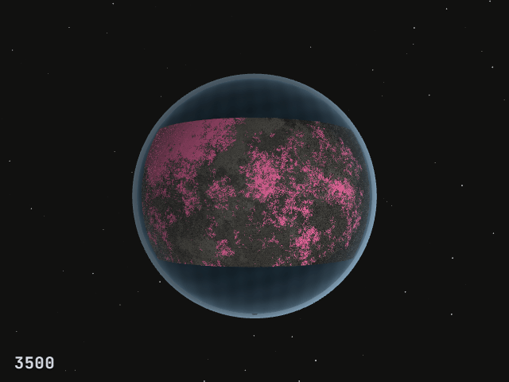
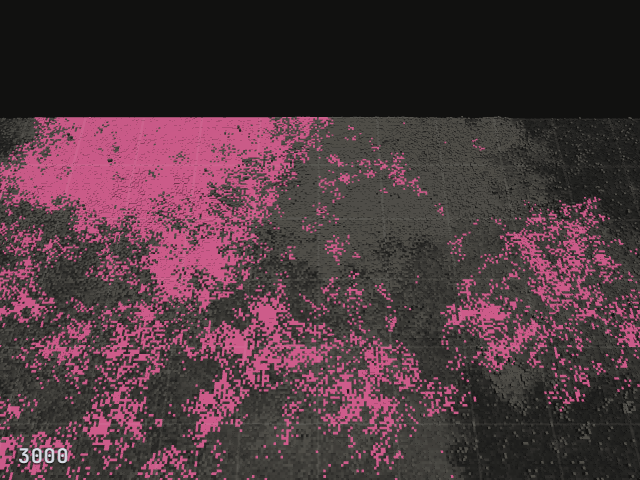
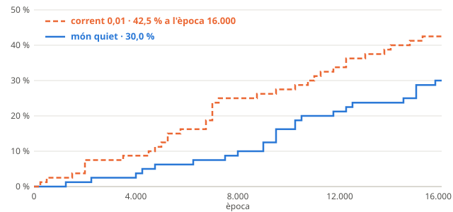

# Genesis

**Digital abiogenesis:** a toy universe where we try to let life arise on its own, without anyone writing the
first organism.

**The website:** <https://xavig-icv.github.io/genesis/>. Explore the worlds from the series in 3D, down to the
code of each cell, and run a new world in your browser.

*This is the English version of the [Catalan README](README.md), which is the main one. It is shorter, and
was last synchronised on 5 November 2026. The lab notebook and most of the documentation are in Catalan. Each
notebook entry has an [English summary](quadern/resum.en.md), and the [glossary](docs/glossari.md) gives the
English term for each Catalan one.*



*A world of 512 × 256 random programs, from epoch 1,500 to 6,000, in the 3D explorer of the
[website](https://xavig-icv.github.io/genesis/). The world is flat and has edges: here it is drawn as a continent on a
planet. The number in the corner is the epoch. At 2,200, the family tracker recognises replicators there and colours
them pink, and at 2,250 life becomes established. Later another family appears, in yellow. Nobody wrote them. This
is the world of seed 1006 from the law-2 series. It was chosen because the colony is easy to see, so it is an
example, not a sample ([where the images come from](docs/imatges/README.md)).*

**What "life" means here.** It is an operational criterion, not a claim about biological life.
- **A heritable replicator** is a program that copies itself into a partner, and whose copy copies itself in
  turn.
- **Life is established** when at least 1% of a sample of 2,048 cells are heritable replicators, in two
  consecutive censuses taken 250 epochs apart.

## What it is

Tierra (1991) and Avida (1994) studied digital evolution, but they started from a hand-written organism.
- **An old idea:** that life can arise spontaneously in a "chemistry" of programs, as in Coreworld, AlChemy
  and Amoeba.
- **Our starting point:** in 2024, *Computational Life* (Agüera y Arcas et al.) showed it in a soup of very
  simple programs written in the BFF language. Self-replicators took over in about 40% of the soups within
  16,000 epochs.

This project starts there, and asks what is still open ([state of the art](docs/estat-questio.md), in Catalan):
1. **Which properties** of the chemistry and of the environment life needs to appear.
2. **What makes it become established and last.**
3. **Whether sustained Darwinian evolution follows.**
4. **Whether the results are general,** or specific to this language.

The main rule: **we design the laws, never the organisms.**
- **What is not there:** seeded replicators, rewards for copying, or any instruction that copies a whole
  program at once.
- **Where the organisms live:** in a closed universe. They are bytes run by our interpreter, with no access to
  the system, the network or files.

## What we have found

**The soup comes alive.**
- **The setting:** soups of 131,072 random programs.
- **What happens:** in some soups, after hundreds or thousands of epochs, a program appears that copies
  itself into others and takes over. This reproduces the 2024 result.
- **What we followed:**
  - **The first replicators poison themselves.** Each copy leaves zeros behind, and zeros stop copying. The
    2024 paper already describes this "zero-poisoning" and the successor that follows (its figure 2); we
    found it in our soups and measured it. This explanation fits all the data, but no intervention experiment
    has proven it.
  - **A resistant successor.** In one soup, a successor replicator turns the zeros into 255 and keeps copying
    in 83–96% of attempts.
  - **Palindromes.** The first three replicators we found are palindromes that copy themselves backwards,
    with the same copy loop. This suggests convergent evolution, but it is a hypothesis.

**In a world with space** (each program interacts only with its neighbours):
- **Quiet worlds:** the replicator family occupies a single area.
- **Worlds with a weak current** (1% of cells moved each epoch): it spreads out.



*The world of seed 1006, close up, from epoch 1,900 to 4,500. Each program only meets its neighbours, and the colony
advances over the surface. The height of each cell is the number of instructions in its program, and the colour is
its family's. The number in the corner is the epoch. Seen from above and in 2D, from epoch 1,500 to 2,900:*


See the sample of eight worlds chosen at random in the [Catalan README](README.md#en-un-món-amb-espai).

**The first preregistered series: inconclusive.** We tested whether a weak current makes life become
established more often, with a protocol written and tagged before starting.
- **The series:** 160 worlds.
- **The result:** life became established in 30% of quiet worlds (24/80) and in 42.5% of worlds with a
  current (34/80).
- **The test:** log-rank Z = −1.83, p = 0.067. The preregistered bound was |Z| > 2.004, so it was not
  reached.
- **The difference at epoch 16,000:** +12.5 points, with a 95% CI from −2.3 to +27.3.
- **What it means:** the series cannot show that the current has an effect, nor rule it out.

<picture>
  <source media="(prefers-color-scheme: dark)" srcset="docs/imatges/llei2-km-fosc.svg">
  
</picture>

**The second preregistered series: established life lasts.** We continued 29 worlds from the moment life
became established, in their original condition and in the other one, with two seeds per condition and 5,000
more epochs: 116 branches ([protocol](docs/protocol-b2.md), in Catalan).
- **In its own world, life lasts.** 93.1% of branches show no sustained loss within 5,000 epochs (95% CI:
  73.8–98.5%).
  - The 4 losses in this condition come early, by *t* + 1,500.
  - All four climb back above 1%.
- **With a current, life occupies on average a larger share of the world** during the first 2,000 epochs:
  confirmed, in 22 of 29 worlds and in both origins (p = 0.004, with Holm's correction).
  - **In the end, both conditions reach very similar levels:** 70.6% and 70.7% over the last 8 censuses
    (descriptive, looked at afterwards, not an equivalence test). The current seems to make life fill the world
    sooner, rather than fill more of it.
  - **Not a discovery:** it is what front-invasion theory leads one to expect. The series measures its size,
    not the speed of any front.
- **Whether life lasts less when its world changes condition:** inconclusive (3 worlds for, 3 against and 23
  ties). Losses are rare and concentrated in a few worlds, and the test had little power, as the protocol
  warned.

See notebook entry 10, in Catalan, or its [English summary](quadern/resum.en.md#entry-10).

**The third preregistered series: the zeros.** In the worlds where life is lost again and again, there are
many more zero bytes when it becomes established (notebook entry 11, in Catalan; [summary](quadern/resum.en.md#entry-11)). In 8 worlds where life drops
right after becoming established, we restarted each world from the same instant, in four ways and with the
same randomness: 132 branches ([protocol](docs/protocol-zeros.md), in Catalan).
- **Against a placebo, removing the zeros makes life drop less, or grow more:** confirmed, in all 8 worlds (p = 0.004,
  with Holm's correction). With the zeros changed, life grows in 5 of the 8.
  - **What is done:** the zeros of the cells that do not replicate become data bytes. The placebo changes, in
    the same cells, as many data bytes as there are zeros, and leaves the zeros in place. It is matched cell by
    cell, partly at the saturated cells: in cells with more zeros than data bytes it falls short, and leaves
    unmatched between 0.5% and 5.0% of the zeros that `zeros-data` changes in each world.
  - **What it means:** within these worlds, the zeros contribute to the drop of life. This is compatible with the
    self-poisoning hypothesis: the replicator leaves behind broken copies full of zeros, and this debris stops
    the next copies. The test does not tell the mechanism: the zeros may also put to sleep the copies that carry
    them.
- **Against the untouched world:** inconclusive (7 worlds for and 1 against, p = 0.035, with a threshold of
  0.025).
- **It says nothing about new worlds,** because these were chosen after seeing their data.
- **Not a discovery:** zero poisoning is already in the 2024 paper. What the series adds is the causal test,
  with an intervention from the same snapshot and a control.

See notebook entry 13, in Catalan, or its [English summary](quadern/resum.en.md#entry-13).

**The fourth preregistered series: how the soup matures.** In a quiet world that reaches epoch 8,000 without
life, does life become established more often if the aged soup is kept than if it is replaced by a fresh one? In
150 new worlds, each world continued for 8,000 more epochs in three ways, from the same snapshot and with the same
randomness: 900 branches ([protocol](docs/protocol-maduracio.md), in Catalan).
- **With the aged soup, life becomes established more often than with a fresh soup:** confirmed, 64 branches of
  300 against 40 (p = 0.007, with calibrated Holm thresholds). It is the total effect of keeping the soup of these
  worlds, not of a specific mechanism.
- **With the aged soup's byte histogram, shuffled, too:** confirmed, 82 against 40 (p = 0.00003). It includes the
  replicators that the shuffle creates at once: it does not isolate the composition.
- **The cohort:** quiet worlds that reach epoch 8,000 without life and without any detected heritable cell. It is
  not a law of all worlds, nor of age in general.
- **Between the aged soup and the shuffled one** there is no test: 21.3% against 27.3%, with no claim of
  equivalence.
- **What was already known:** Knierim et al. (2026) find that, with the distribution of the bytes a soup writes,
  random search finds the first replicator about 17 times sooner than with uniform bytes. That leads one to expect
  the result for the shuffled soup, but says nothing about the aged soup as it is.

See notebook entry 14, in Catalan, or its [English summary](quadern/resum.en.md#entry-14).

**The ingredients of the chemistry.** Which ingredients of the chemistry does a random program need to copy itself?
We tested 10⁷ random programs with the usual chemistry and with twelve variants, each with one rule changed, and
counted how many are heritable replicators ([plan](docs/pla-b1.md), in Catalan). This is the first level: whether
replicators exist and are abundant, not whether they become established in a soup. Everything is descriptive.
- **The three controls give zero, as expected:** without copy instructions, without loops or without any copying
  from one program to the other, no replicator in 10⁷ programs. They were chosen to block the known ways of
  replicating, and a zero does not prove that there can be none. With the usual chemistry, 1,625.
- **A single copy instruction is enough,** with fewer replicators: with `,`, 71% as many as with the usual
  chemistry, and with `.`, 39%.
- **Some rules get in the way:** without arithmetic, there are twice as many replicators, and if a program cannot
  rewrite itself, four times as many.
- **With the two heads aligned,** each at the start of a program, there are 31 times as many. Knierim et al. (2026)
  already point to this, with another chemistry.
- **The limits:** with random bytes like those of a fresh soup, the test finds 44 times fewer, and none copies
  itself: with inert partners, none of the 37 copies, and the copying was done by the test's random partner (the
  autonomy test, 12 November 2026). The test also counts those the partner helps.

See notebook entry 15, in Catalan, or its [English summary](quadern/resum.en.md#entry-15).

**The soup before life (exploratory).** What happens in the soup before life appears? Since 11 November 2026 the
project focuses on this question, after an evaluation of our own and of both auditors. The first step used the data we
already had, with no new simulation, and everything in it is exploratory: a lead, not a result.
- **The lifeless soup matures the same way in every world,** piling up instructions, mainly `<`, crowded into a few
  programs. Flow speeds it up.
- **Yet an aged soup has fewer self-copying programs than a fresh one,** by the census test, and the few replicators
  that appear are lost at once. Whether life becomes established there more often because more replicators appear,
  because more of them take root, or both, we do not know yet (consultation X-105).
- **Establishment has a chance component:** the two branches of the same world behave in a way compatible with
  independence, with little power.
- **The isolated heritable cells that show up now and then in scans are false positives of autonomy:** the random
  partner does the copying. They must be retested before being counted.
- **What does not hold:** that the establishment rate follows maturation, and that the life which becomes
  established is made of what the soup piles up. Both auditors showed it.
- **What was already known:** the idea of a phase in which instructions become biased was described in the Amoeba
  system (Greenbaum and Pargellis, 2017). A specific mechanism in BFF, tested by intervention, could be new.

See notebook entry 16, in Catalan, or its [English summary](quadern/resum.en.md#entry-16).

**Who copies itself (exploratory).** Of the random replicators of the ingredients of the chemistry, which copy
themselves without the code of the test's partner? We retested them with partners that have no instructions, and
counted replicators by the share of instructions in the programs ([plan](docs/pla-b1.md), in Catalan). Everything is
exploratory.
- **With half of the bytes being instructions,** half of the replicators copy themselves in some condition, and 18% in
  all of them. With the bytes of a fresh soup, none.
- **The more instructions, the more replicators,** but below 9 instructions none copies itself: the test's partner
  copies those. With 10% instructions, only 3% of those the test finds copy themselves.
- **Composition matters:** with that of an aged soup, about 6 in 10 million programs copy themselves; with random bytes,
  none in 10 million. This is Adami and LaBar's (2017) "biased typewriter", which Knierim et al. (2026) had already seen
  in BFF; here, without the partner's help.
- **For the soup before life:** the counts made with the census test must be redone with partners that have no
  instructions. That is the next step.

See notebook entry 17, in Catalan, or its [English summary](quadern/resum.en.md#entry-17).

**Who writes the bytes, and who really copies itself (exploratory).** The second step of the soup before life, with the
snapshots of the series and no new simulation.
- **`<` spreads by being copied,** mostly from programs that already start with `<`: they make 55% of the new ones,
  about 7 times their share. The first-byte rule has a strong effect.
- **Almost all the "replicators" found by the scan were the work of the test's partner:** with partners that have no
  instructions, 0.07 cells per soup copy themselves in an aged soup, 5.9 in a fresh one, and 111 in the same bytes
  shuffled.
- **The order holds in all 150 worlds:** the arrangement of the aged soup undoes what its composition would do.
- **At the start, no soup has ready-made replicators.** Whether maturation acts on their appearance or on their taking
  root, we do not know yet.

See notebook entry 18, in Catalan, or its [English summary](quadern/resum.en.md#entry-18).

**What we study now:**
- **The soup before life:** a pilot that measures separately whether a replicator appears and whether it takes root,
  in new worlds, with arms that keep the composition and change the arrangement ([decisions](docs/disseny.md), in
  Catalan).
- **The ingredients of the chemistry:** the exploratory computation is done (entry 17). Level 2, the soup, if it is
  done, with a preregistered design.

## How we work

- **Preregistration.** Confirmatory series have a protocol written before starting
  ([law-2 protocol](docs/protocol-estadistic.md), [B2 protocol](docs/protocol-b2.md),
  [zeros protocol](docs/protocol-zeros.md) and [maturation protocol](docs/protocol-maduracio.md), in Catalan). The
  deciding program only decides from a copy identical to the git tag of the preregistration.
- **Two auditors, both AI.**
  - **What they do:** at each iteration, two models review the code, the methods and the results, in
    separate sessions.
  - **Who they are:** one is another instance of Claude, the same model that develops the project; the other
    is a different model.
  - **How it is sealed:** each seals its report before reading the other's.
  - **What we check:** we verify every finding with data. The [audit index](docs/auditories.md), in
    Catalan, lists every finding and how it was resolved.

  **This is not human peer review.**
- **Mistakes are corrected without deleting.** The notebook keeps what we said, and adds a dated correction.
- **Each world's history is exactly reproducible.** With the same commit, seed and parameters, the browser
  and Node produce the same history. Only the higher-order entropy differs slightly between Node versions,
  because of zlib. See [how to reproduce the results](docs/reproduir.md), in Catalan, with commands.
- **Who works on it.** Claude (Anthropic) develops it, with a human project owner who sets the direction and
  reviews every change to the simulator before accepting it.

## Status and limits

- **A personal project in progress,** started on 14 October 2026. The results are preliminary, and have not
  been published or reviewed by human experts.
- **The law-2 preregistration** is the git tag `preregistre-llei2`.
  - **What can be checked:** the commit and the file fingerprints.
  - **What cannot:** the date, because git does not certify it and the repository was private.
- **The B2 preregistration** is the git tag `preregistre-b2`, with an OpenTimestamps proof anchored in
  Bitcoin ([`docs/preregistre-b2/`](docs/preregistre-b2/), in Catalan).
  - **What Bitcoin proves:** that the tag existed when block 972,374 was mined (20:25:42 UTC on 20 October
    2026), about 6 minutes after the first branch started.
  - **What it does not prove:** that the stamp was sent 31 minutes earlier is recorded by the calendars, and
    that nobody looked at any result is stated in the run log.
- **The zeros-test preregistration** is the git tag `preregistre-zeros`, with an OpenTimestamps proof anchored
  in Bitcoin ([`docs/preregistre-zeros/`](docs/preregistre-zeros/), in Catalan).
  - **What Bitcoin proves:** that the tag existed when block 973,367 was mined (07:43:35 UTC on 27 October
    2026), 51 minutes before the first branch started. This time we waited for the anchor before launching.
  - **What it does not prove:** that nobody looked at any result. That is stated in the run log.
- **The maturation-series preregistration** is the git tag `preregistre-maduracio`, with an OpenTimestamps proof
  anchored in Bitcoin ([`docs/preregistre-maduracio/`](docs/preregistre-maduracio/), in Catalan).
  - **What Bitcoin proves:** that the tag existed when block 974,134 was mined (14:21:50 UTC on 1 November 2026),
    75 minutes before the first branch started. Again, we waited for the anchor before launching.
  - **What it does not prove:** that nobody looked at any result. That is stated in the run log.
- **The former name:** until 30 October 2026 the project was called claude-origins, the name that still appears in
  the experiment records and in the audits.
- **How to cite it:** [`CITATION.cff`](CITATION.cff). **How to take part:** [`CONTRIBUTING.md`](CONTRIBUTING.md).

## How to run it

**The website:** <https://xavig-icv.github.io/genesis/>, in Catalan and English: three worlds from the series in 3D and 2D, down
to the code of each cell, and a new world that runs in your browser with the same simulator. It is published with GitHub Pages
from `main`, and the data of the worlds are checked against their SHA-256 before publishing.

To run everything locally:

You need Node.js, and nothing else. For a new setup, use a maintained version (Node 22 or 24): the tests pass
there. Versions 16 and 20 are those of the historical records, and are only needed to reproduce them byte for
byte.

```bash
node server.mjs
```

Open <http://localhost:8420> to see the soup, the 2D world (with zoom from territories down to code) and the
notebook. It needs module workers and `CompressionStream` with `deflate-raw`. Chromium-based browsers (Chrome,
Edge) are the ones reproducibility was checked with.

A quick run without graphics, of about 10–15 seconds:

```bash
node sim.mjs --world 64x64 --seed 1 --epochs 300 --census 100
```

**A world the size of the series,** up to epoch 16,000, takes about an hour (median), and up to a bit over
three hours. `node sim.mjs --help` lists every option, and `npm test` runs the tests.

## Licence and credits

- **Code:** GNU AGPL v3 or later ([`LICENSE`](LICENSE)). Until 5 November 2026, Apache 2.0. The reference function
  adapted from cubff keeps its Apache 2.0 licence ([`LICENSES/Apache-2.0.txt`](LICENSES/Apache-2.0.txt)).
- **Notebook and documentation:** CC BY 4.0 ([`LICENSE-docs.md`](LICENSE-docs.md)).
- **Experimental data:** CC BY 4.0 ([`LICENSE-data.md`](LICENSE-data.md)).
- **Credits** ([`NOTICE`](NOTICE)).
  - The simulator is an independent JavaScript reimplementation of the BFF language of *Computational Life*
    (Agüera y Arcas et al., 2024, arXiv:2406.19108), checked against cubff, its reference implementation
    (Google LLC, Apache 2.0).
  - The test bench includes a reference function adapted from cubff's `bff.inc.h`, with attribution in
    `NOTICE`.
  - The project builds on that work. It does not claim as original that replicators arise on their own in a
    BFF soup.
