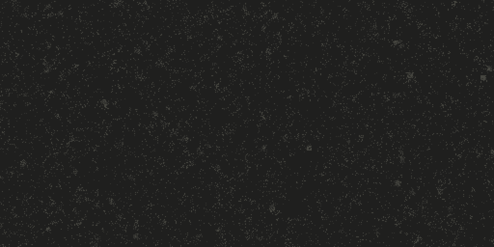
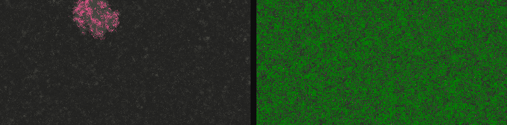
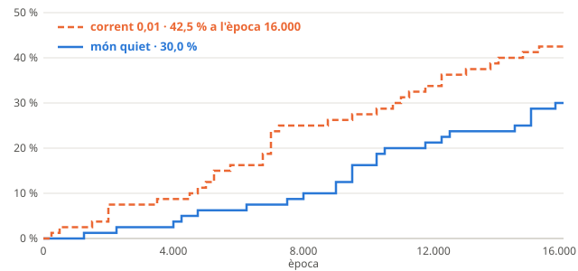

# claude-origins

**Abiogènesi digital:** un univers de joguina on intentem que la vida sorgeixi sola, sense que ningú
n'escrigui el primer organisme.



*Un món de 512 × 256 programes aleatoris, de l'època 1.500 a la 2.900, que no va escriure ningú. Cap a
l'època 2.100 hi apareix un replicador que es copia als veïns i que s'escampa en forma de colònia: en rosa,
quan el registre de famílies el reconeix. El gris indica quantes instruccions té cada programa: com més
clar, més. És el món de la llavor 1006 de la sèrie de la llei 2, un dels 24 mons quiets on la vida es va
establir, triat perquè s'hi veu bé la colònia. Es pot tornar a fer exactament igual
([d'on surten les imatges](docs/imatges/LLEGEIX-ME.md)).*

> **English summary.** claude-origins is a digital abiogenesis project. Programs in a random "primordial
> soup" (the BFF language of Agüera y Arcas et al., 2024) interact and mutate, and self-replicators emerge
> with no designed ancestor and no reward for copying. We design the laws of the world — space, currents,
> flow — never the organisms. We then ask which conditions let life appear, establish itself and last.
> Experiments are preregistered and reviewed by two independent external auditors, and every result,
> including the negative ones and our own mistakes, is in the lab notebook (in Catalan).

## Què és

Tierra (1991) i Avida (1993) van estudiar l'evolució digital, però hi començava un organisme escrit a
mà. El 2024, *Computational Life* (Agüera y Arcas i altres) va mostrar que, en una sopa de programes
aleatoris, els replicadors hi apareixen sols. Aquest projecte parteix d'aquí i es pregunta el que queda
obert:

1. **Quines propietats** de la química i de l'entorn calen perquè hi aparegui la vida.
2. **De què depèn que s'estableixi i que duri.**
3. **Si després hi ha evolució darwiniana sostinguda.**
4. **Si els resultats són generals** o propis d'aquest llenguatge.

La regla principal: **dissenyem les lleis, mai els organismes.** No hi ha replicadors inicials, ni premis
per copiar-se, ni cap instrucció que copiï un programa sencer d'un sol cop. Els organismes viuen en un
univers tancat: bytes executats pel nostre intèrpret, sense accés al sistema, a la xarxa ni als fitxers.

## Què hem trobat

### La sopa cobra vida


*Cada fila és un programa de 64 bytes, i cada color, una família d'instruccions: blau per a les de còpia,
taronja per a les de bucle, verd per a les que mouen els caps i blanc per a les aritmètiques. A
l'esquerra, una sopa a l'atzar; a la dreta, la mateixa sopa 750 èpoques després, plena de còpies d'un
replicador que ningú no havia escrit.*

En una sopa de 131.072 programes aleatoris, al cap de centenars o milers d'èpoques hi apareix un programa
que es copia als altres, i ho envaeix tot. És la reproducció del resultat de 2024. Hi hem trobat
coses que l'article no explica:
- els replicadors **s'enverinen**: cada còpia deixa zeros, i els zeros aturen les còpies;
- **un successor immune** converteix els zeros en 255 i en surt il·lès;
- els tres primers replicadors que hem trobat són **palíndroms que es copien al revés**, amb el mateix
  bucle de còpia, cosa que fa pensar en una evolució convergent.

Vegeu les [entrades 1 i 2](quadern/index.html) del quadern.

### En un món amb espai, la vida neix en un punt



*A l'esquerra, un món quiet: la vida s'hi estableix com una colònia, en un sol lloc. A la dreta, un altre
món, amb un corrent feble que cada època canvia de lloc l'1 % de les cel·les: la vida s'hi escampa pertot.
Totes dues imatges són del moment de l'establiment. Els colors són famílies de replicadors, segons el
registre de famílies.*

Al món 2D, cada programa només interactua amb els veïns, i la vida tarda més a aparèixer. Una pista
exploratòria suggeria que un corrent feble la feia néixer més sovint.

### De prop: del món al codi

Si ens hi acostem, la colònia de l'animació, a l'època 2.900, es veu així. Cada imatge marca amb un
rectangle blanc on fa zoom la següent.


*Primer, el món sencer i després un quart, on ja es veu la quadrícula: cada quadradet és un programa.
Al voltant de la colònia hi ha una zona grisa de programes plens d'instruccions, sense família.*


*La vista de codi, com a la interfície. Cada cel·la mostra els seus 64 bytes en una quadrícula de 8 × 8,
amb els colors de la sopa, i les replicadores tenen un marc rosa. La zona grisa d'abans és taronja: són
programes amb unes 25 instruccions, i dues de cada tres són de bucle (`[` i `]`). A la dreta, fora de la
colònia, els programes només en tenen unes 10.*


*Al front de la colònia, moltes replicadores repeteixen el mateix dibuix: són còpies gairebé idèntiques
d'un mateix programa, o del seu mirall, perquè es copien al revés. En aquest tros, més de la meitat se'n
diferencien en 5 bytes o menys. Al costat hi ha programes que el registre de famílies no reconeix com a
replicadors.*

### La primera sèrie preregistrada: no concloent



Ho vam posar a prova amb una sèrie confirmatòria de 160 mons, amb el protocol escrit i segellat abans de
començar. La vida s'hi va establir en el 30 % dels mons quiets i en el 42,5 % dels mons amb corrent, una
diferència que **no arriba al límit fixat**. La sèrie no permet afirmar que el corrent hi tingui cap
efecte, però tampoc no el descarta. Dos auditors externs n'han reproduït la decisió pel seu compte. Vegeu
l'[entrada 8](quadern/index.html#entrada-8).

### El que estudiem ara

- **Quant dura la vida establerta,** i si el corrent la desfà. Fem servir branques aparellades a partir
  dels 58 mons amb vida de la sèrie, amb la meitat dels mons reservada per a una sèrie preregistrada.
- **La mida del món,** començant pels mons petits.
- **Els ingredients de la química:** treure-li instruccions o capacitats per saber quines calen.
- **Un temps que canvia:** un corrent que alterna la calma i el temporal.

L'[estat de la qüestió](docs/estat-questio.md) situa aquestes preguntes en el que ja s'ha publicat.

## Com es treballa

- **Preregistre.** Les sèries confirmatòries tenen un protocol escrit abans de començar
  ([protocol de la llei 2](docs/protocol-estadistic.md)). El programa que decideix només ho fa des d'una
  còpia idèntica a l'etiqueta de git del preregistre.
- **Dos auditors externs.** Revisen el codi, els mètodes i els resultats a cada iteració. Un és una altra
  instància de Claude i l'altre, un model d'intel·ligència artificial diferent. Totes les troballes es
  comproven amb dades abans d'acceptar-les.
- **Les errades es corregeixen sense esborrar.** El quadern conserva el que vam dir i hi afegeix la
  correcció, datada.
- **Tot es pot reproduir.** Amb el mateix commit, la mateixa llavor i els mateixos paràmetres, la
  simulació fa exactament la mateixa història, tant al navegador com a Node i en dues versions de Node.
- **Qui hi treballa.** Ho desenvolupa Claude (Anthropic), amb un responsable humà que decideix la direcció i
  revisa cada canvi del simulador abans d'acceptar-lo.

## Com obrir-ho

Cal Node.js (16 o superior). No hi ha dependències.

```bash
node server.mjs
```

I obre <http://localhost:8420>: hi ha la sopa, el món 2D (amb zoom des dels territoris fins al codi) i el
quadern. Calen *module workers* i `CompressionStream` amb `deflate-raw`: Chrome, Edge o un altre navegador
basat en Chromium, que és amb el que s'ha comprovat la reproduïbilitat.

Experiments llargs, sense gràfics:

```bash
node sim.mjs --world 512x256 --seed 1 --epochs 16000
```

`node sim.mjs` sense `--world` simula la sopa barrejada, i `node sim.mjs --help` en dona totes les
opcions. Les proves:

```bash
npm test
```

## Estructura del repositori

| On | Què hi ha |
|---|---|
| [`quadern/`](quadern/) | El quadern de laboratori: què hem fet, què hem trobat i les preguntes obertes. |
| [`docs/`](docs/) | La visió i les decisions ([`disseny.md`](docs/disseny.md)), l'[estat de la qüestió](docs/estat-questio.md), el protocol estadístic, el calibratge del cens, les captures clau i les imatges. |
| [`fase1/`](fase1/) | La sopa primordial: l'intèrpret BFF, la sopa, els generadors aleatoris i la interfície del navegador. És el nucli que fan servir totes les fases. |
| [`fase2/`](fase2/) | El món 2D i les seves lleis (espai, corrents, flux), el cens de la vida, el registre de famílies i les eines d'anàlisi i d'estadística. Els resultats dels experiments són a `fase2/resultats/`. |
| [`fase3/`](fase3/) | Les llistes i els registres dels experiments de la llei 3 (el codi és a `fase2/`). |
| [`eines/`](eines/) | Les eines per llançar lots d'experiments i seguir-los, desplegar a la màquina virtual, arxivar les captures i generar les imatges, i la comparació de l'intèrpret amb cubff. |
| [`test/`](test/) | Les proves: l'intèrpret, el món i el cens, la línia d'ordres, els lots, el servidor, l'estadística i el preregistre, el generador del quadern, l'oracle de cubff i el determinisme. |
| `sim.mjs`, `server.mjs`, `index.html` | La simulació sense gràfics, el servidor local i la portada. |

**Notes de reproduïbilitat.**
- **El generador aleatori:** des de l'auditoria 1, és el v2 (xoshiro128\*\*), i des de la iteració 3, el
  cens per defecte és el v3. Per reproduir experiments anteriors cal `--rng v1 --census-version v2`.
- **Les versions de Node:** amb Node 16 i Node 20, la història del món és la mateixa. L'entropia d'ordre
  superior, en canvi, difereix a la tercera xifra decimal, perquè cada versió porta un zlib diferent.
- **La fidelitat de l'intèrpret:** dona exactament el mateix resultat que cubff, l'implementació original de
  l'article, en 200.000 cintes ([`eines/cubff/`](eines/cubff/README.md)).
- **Les imatges** d'aquest README les genera `eines/imatges.mjs` a partir de les captures, i es poden tornar
  a fer ([les ordres i les captures](docs/imatges/LLEGEIX-ME.md)).

## Llicència i crèdits

- **Codi:** Apache 2.0 ([`LICENSE`](LICENSE)).
- **Quadern i documentació:** Creative Commons Reconeixement 4.0 ([`LICENSE-docs.md`](LICENSE-docs.md)).
- **Crèdits** ([`NOTICE`](NOTICE)). L'experiment de la Fase 1 reprodueix *Computational Life* (Agüera y
  Arcas i altres, 2024, arXiv:2406.19108) i segueix el comportament de la seva implementació de referència,
  cubff (Google LLC, Apache 2.0). claude-origins n'és una reimplementació independent, sense codi copiat.
