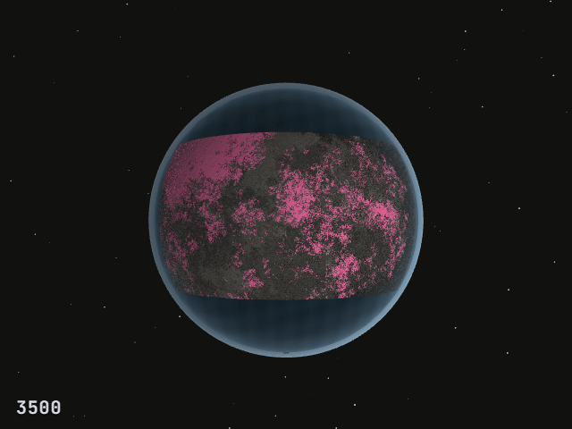
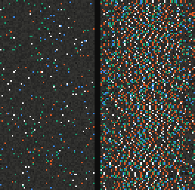
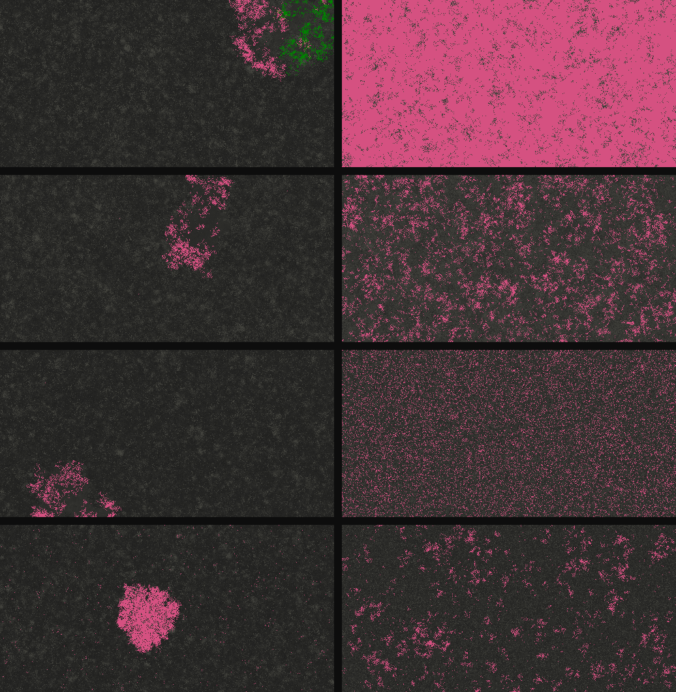
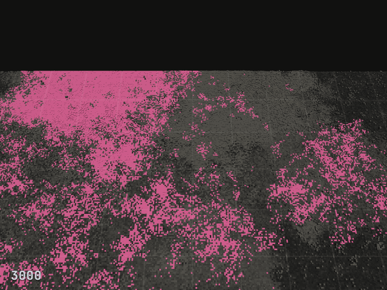
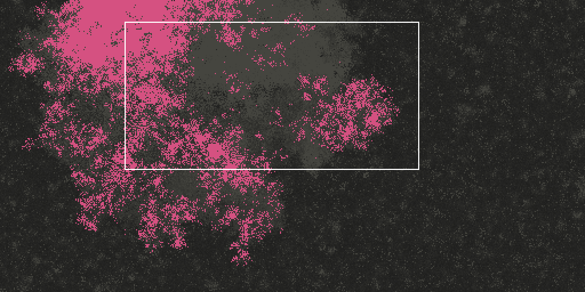
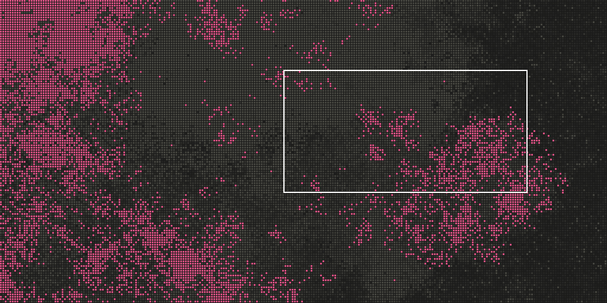
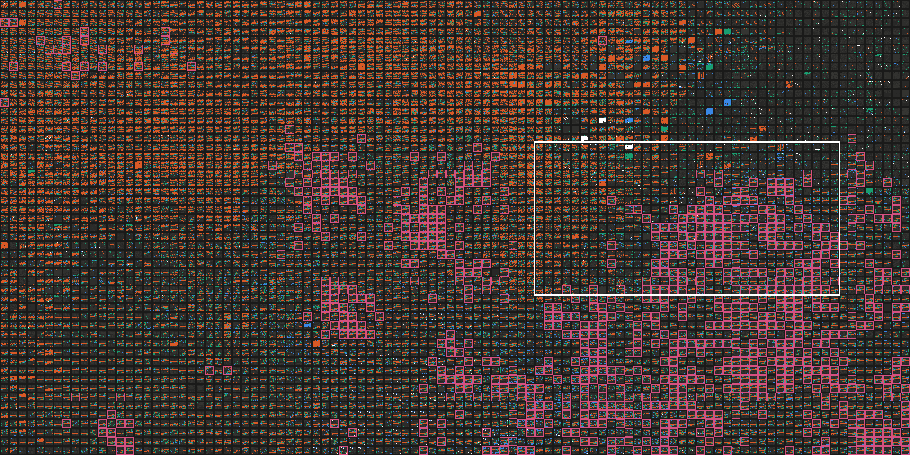
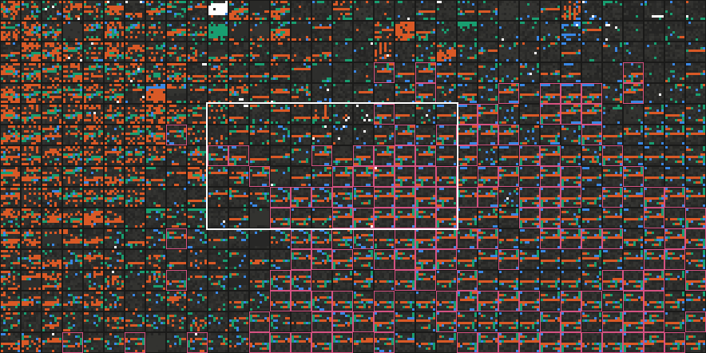
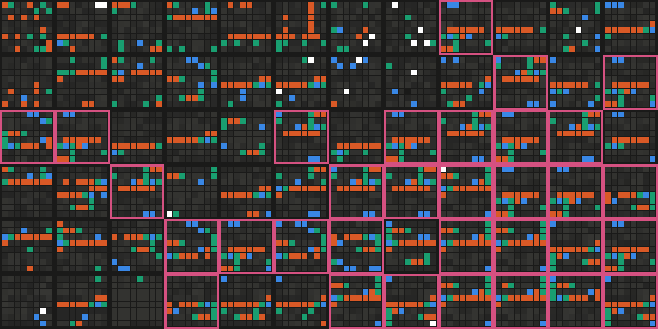
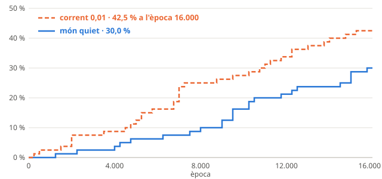

# Genesis

**Digital abiogenesis:** a toy universe where we try to let life arise on its own, without anyone writing the
first organism.

**The website:** <https://xavig-icv.github.io/genesis/>. Explore the worlds from the series in 3D, down to the
code of each cell, and run a new world in your browser.

**Català:** [README.ca.md](README.ca.md) · **Catalan–English glossary:** [docs/glossari.md](docs/glossari.md)

*English is the project's main language since 22 November 2026, and Catalan the second one. The lab notebook and most
of the documentation were written in Catalan, and the originals stay as they are, with their dates. Each notebook entry
has an [English summary](quadern/resum.en.md), and the full translations are on their way.*



*A world of 512 × 256 random programs, from epoch 1,500 to 6,000, in the 3D explorer of the
[website](https://xavig-icv.github.io/genesis/). The world is flat and has edges: here it is drawn as a continent on a
planet. The number in the corner is the epoch. At 2,200, the family tracker recognises replicators there and colours
them pink, and at 2,250 life becomes established. Later another family appears, in yellow. Nobody wrote them. This
is the world of seed 1006 from the law-2 series. It was chosen because the colony is easy to see, so it is an
example, not a sample ([where the images come from](docs/imatges/README.md)).*

**What "life" means here.** It is an operational criterion, not a claim about biological life.
- **A heritable replicator** is a program that copies itself into a partner, and whose copy copies itself in
  turn.
- **Life is established** when at least 1% of a sample of 2,048 cells are heritable replicators, in two
  consecutive censuses taken 250 epochs apart.

**Who does the work.** The code is written by Claude (Anthropic) under the direction of a human project owner, and
reviewed by **two AI auditors**. **This is not human peer review.**

## What it is

Tierra (1991) and Avida (1994) studied digital evolution, but they started from a hand-written organism.
- **An old idea:** that life can arise spontaneously in a "chemistry" of programs, as in Coreworld, AlChemy
  and Amoeba.
- **Our starting point:** in 2024, *Computational Life* (Agüera y Arcas et al.) showed it in a soup of very
  simple programs written in the BFF language. Self-replicators took over in about 40% of the soups within
  16,000 epochs.

This project starts there, and asks what is still open ([state of the art](docs/estat-questio.md), in Catalan):
1. **Which properties** of the chemistry and of the environment life needs to appear.
2. **What makes it become established and last.**
3. **Whether sustained Darwinian evolution follows.**
4. **Whether the results are general,** or specific to this language.

The main rule: **we design the laws, never the organisms.**
- **What is not there:** seeded replicators, rewards for copying, or any instruction that copies a whole
  program at once.
- **Where the organisms live:** in a closed universe. They are bytes run by our interpreter, with no access to
  the system, the network or files.

## What we have found

### The soup comes alive



*Each row is a 64-byte program, and each colour a family of instructions:*
- *blue: copy;*
- *orange: loops;*
- *green: head moves;*
- *white: arithmetic.*

*On the left, the initial soup of seed 1. On the right, the same soup 750 epochs later, full of copies of a
replicator nobody had written.*

**The soups:** 131,072 random programs.
- **In the paper:** after hundreds or thousands of epochs, a program appears in some soups that copies itself into
  the others and takes over. It happens in about 40% of the soups within 16,000 epochs.
- **In the project:** it also happens in some soups and not in others.

We reproduced the 2024 result, and followed its history:
- **The first replicators poison themselves.** Each copy leaves zeros behind, and zeros stop copying. The 2024
  paper already describes this poisoning and the successor that follows (its figure 2); we found it in our soups
  and measured it. It is the explanation that fits the data, but we have not proven it with an intervention.
- **A resistant successor.** In one soup, a new replicator turns the zeros into 255 and keeps copying itself in
  83–96% of attempts.
- **Palindromes.** The first three replicators we found are palindromes that copy themselves backwards, with the
  same copy loop. This suggests convergent evolution, but it is a hypothesis.

See notebook [entries 1 and 2](quadern/index.html#entrada-1), in Catalan, or their [English summary](quadern/resum.en.md).

### In a world with space



*Four worlds of each condition, chosen at random among those where life became established, with a declared seed.
Each image is from the moment of establishment.*
- *On the left, the quiet worlds. The replicator family occupies a single area, or two.*
- *On the right, worlds with a weak current, which moves 1% of the cells each epoch. The family spreads out.*
- *What the colour marks: each family's territory, that is, the cells that carry its core of code, not only the
  working replicators.*
- *The census figures:*
  - *in the quiet worlds, heritable replicators make up 1.0% to 3.7%;*
  - *in the worlds with a current, 2.4% to 85.5%.*

In the 2D world, each program interacts only with its neighbours. The first observations suggested that space slows
life down, and that a weak current makes it become established more often.



*The world of seed 1006, close up, from epoch 1,900 to 4,500. Each program only meets its neighbours, and the colony
advances over the surface. The height of each cell is the number of instructions in its program, and the colour is
its family's. The number in the corner is the epoch.*

### Close up: from the world to the code


*The same world, from above, from epoch 1,500 to 2,900. Around 2,100 a patch of programs full of instructions
appears. At 2,200, the family tracker recognises replicators there and colours them pink.*

Zooming in, the colony of the animation looks like this at epoch 2,900. Each image marks with a white rectangle where
the next one zooms in.





*First the whole world, then a quarter, where the grid is already visible: each small square is a program. Around the
colony there is a grey zone of programs full of instructions, with no family.*



*The code view, as in the interface.*
- *Each cell shows its 64 bytes in an 8 × 8 grid, with the soup's colours.*
- *Replicators have a pink frame.*
- *The grey zone from before shows up orange. These are programs with about 25 instructions, two in three of them
  loops (`[` and `]`).*
- *On the right, outside the colony, programs have only about 10.*





*At the front of the colony, many replicators repeat the same pattern.*
- *They are almost identical copies of one program, or of its mirror image, because they copy themselves backwards.*
- *In this patch, more than half of them differ by 5 bytes or fewer.*
- *Next to them are programs that the family tracker does not recognise as replicators.*

### The first preregistered series: inconclusive

<picture>
  <source media="(prefers-color-scheme: dark)" srcset="docs/imatges/llei2-km-fosc.svg">
  
</picture>

*The series:* 80 worlds per condition.
- *The test:* log-rank, Z = −1.83 (*p* = 0.067), with a preregistered bound of 2.004.
- *The difference at epoch 16,000:* +12.5 points, with a 95% confidence interval from −2.3 to +27.3.

We tested whether a weak current makes life become established more often, with a confirmatory series of 160 worlds and
a protocol written and sealed before starting.
- **The result:** life became established in 30% of the quiet worlds (24 of 80) and in 42.5% of the worlds with a
  current (34 of 80).
- **The bound:** the difference **does not reach it**.
- **What it means:** the series cannot show that the current has an effect, nor rule it out.
- **The review:** both auditors recomputed the decision on their own.

See notebook [entry 8](quadern/index.html#entrada-8), in Catalan, or its [English summary](quadern/resum.en.md#entry-8).

### The second preregistered series: established life lasts

We continued 29 worlds from the moment life became established, in their original condition and in the other one, with
two seeds per condition and 5,000 more epochs: 116 branches ([protocol](docs/protocol-b2.md), in Catalan).
- **In its own world, life lasts.** 93.1% of branches show no sustained loss within 5,000 epochs (95% CI:
  73.8–98.5%).
  - The 4 losses in this condition come early, by *t* + 1,500.
  - All four climb back above 1%.
- **With a current, life occupies on average a larger share of the world** during the first 2,000 epochs: confirmed, in
  22 of 29 worlds and in both origins (*p* = 0.004, with Holm's correction).
  - **In the end, both conditions reach very similar levels:** 70.6% and 70.7% over the last 8 censuses (descriptive,
    looked at afterwards, not an equivalence test). The current seems to make life fill the world sooner, rather than
    fill more of it.
  - **Not a discovery:** it is what front-invasion theory leads one to expect. The series measures its size, not the
    speed of any front.
- **Whether life lasts less when its world changes condition:** inconclusive (3 worlds for, 3 against and 23 ties).
  Losses are rare and concentrated in a few worlds, and the test had little power, as the protocol warned.

See notebook [entry 10](quadern/index.html#entrada-10), in Catalan, or its [English summary](quadern/resum.en.md#entry-10).

### The third preregistered series: the zeros

In the worlds where life is lost again, there are many more zero bytes when it becomes established (notebook
[entry 11](quadern/index.html#entrada-11), in Catalan; [summary](quadern/resum.en.md#entry-11)). In 8 worlds where life
drops right after becoming established, we restarted each world from the same instant, in four ways and with the same
randomness: 132 branches ([protocol](docs/protocol-zeros.md), in Catalan).
- **Against a placebo, removing the zeros makes life drop less, or grow more:** confirmed, in all 8 worlds (*p* = 0.004,
  with Holm's correction). With the zeros changed, life grows in 5 of the 8.
  - **What is done:** the zeros of the cells that do not replicate become data bytes. The placebo changes, in the same
    cells, as many data bytes as there are zeros, and leaves the zeros in place. It is matched cell by cell, partly at the
    saturated cells: in cells with more zeros than data bytes it falls short, and leaves unmatched between 0.5% and 5.0%
    of the zeros that `zeros-data` changes in each world.
  - **What it means:** within these worlds, the zeros contribute to the drop of life. This is compatible with the
    self-poisoning hypothesis: the replicator leaves behind broken copies full of zeros, and this debris stops the next
    copies. The test does not tell the mechanism: the zeros may also put to sleep the copies that carry them.
- **Against the untouched world:** inconclusive (7 worlds for and 1 against, *p* = 0.035, with a threshold of 0.025).
- **It says nothing about new worlds,** because these were chosen after seeing their data.
- **Not a discovery:** zero poisoning is already in the 2024 paper. What the series adds is the causal test, with an
  intervention from the same snapshot and a control.

See notebook [entry 13](quadern/index.html#entrada-13), in Catalan, or its [English summary](quadern/resum.en.md#entry-13).

### The fourth preregistered series: how the soup matures

In a quiet world that reaches epoch 8,000 without life, does life become established more often if the aged soup is kept
than if it is replaced by a fresh one? In 150 new worlds, each world continued for 8,000 more epochs in three ways, from
the same snapshot and with the same randomness: 900 branches ([protocol](docs/protocol-maduracio.md), in Catalan).
- **With the aged soup, life becomes established more often than with a fresh soup:** confirmed, 64 branches of 300
  against 40 (*p* = 0.007, with calibrated Holm thresholds). It is the total effect of keeping the soup of these worlds,
  not of a specific mechanism.
- **With the aged soup's byte histogram, shuffled, too:** confirmed, 82 against 40 (*p* = 0.00003). It includes the
  replicators that the shuffle creates at once: it does not isolate the composition.
- **The cohort:** quiet worlds that reach epoch 8,000 without life and without any detected heritable cell. It is not a
  law of all worlds, nor of age in general.
- **Between the aged soup and the shuffled one** there is no test: 21.3% against 27.3%, with no claim of equivalence.
- **What was already known:** Knierim et al. (2026) find that, with the distribution of the bytes a soup writes, random
  search finds the first replicator about 17 times sooner than with uniform bytes. That leads one to expect the result
  for the shuffled soup, but says nothing about the aged soup as it is.

See notebook [entry 14](quadern/index.html#entrada-14), in Catalan, or its [English summary](quadern/resum.en.md#entry-14).

### The ingredients of the chemistry

Which ingredients of the chemistry does a random program need to copy itself? We tested 10⁷ random programs with the
usual chemistry and with twelve variants, each with one rule changed, and counted how many are heritable replicators
([plan](docs/pla-b1.md), in Catalan). This is the first level: whether replicators exist and are abundant, not whether
they become established in a soup. Everything is descriptive.
- **The three controls give zero, as expected:** without copy instructions, without loops or without any copying from
  one program to the other, no replicator in 10⁷ programs. They were chosen to block the known ways of replicating, and a
  zero does not prove that there can be none. With the usual chemistry, 1,625.
- **A single copy instruction is enough,** with fewer replicators: with `,`, 71% as many as with the usual chemistry,
  and with `.`, 39%.
- **Some rules get in the way:** without arithmetic, there are twice as many replicators, and if a program cannot
  rewrite itself, four times as many.
- **With the two heads aligned,** each at the start of a program, there are 31 times as many. Knierim et al. (2026)
  already point to this, with another chemistry.
- **The limits:** with random bytes like those of a fresh soup, the test finds 44 times fewer, and none copies itself:
  with inert partners, none of the 37 copies, and the copying was done by the test's random partner (the autonomy test,
  12 November 2026). The test also counts those the partner helps.

See notebook [entry 15](quadern/index.html#entrada-15), in Catalan, or its [English summary](quadern/resum.en.md#entry-15).

### The soup before life (exploratory)

What happens in the soup before life appears? Since 11 November 2026 the project focuses on this question, after an
evaluation of our own and of both auditors. The first step used the data we already had, with no new simulation, and
everything in it is exploratory: a lead, not a result.
- **The lifeless soup matures the same way in every world,** piling up instructions, mainly `<`, crowded into a few
  programs. A current speeds it up.
- **Yet an aged soup has fewer self-copying programs than a fresh one,** by the census test, and the few replicators
  that appear are lost at once. Whether life becomes established there more often because more replicators appear,
  because more of them take root, or both, we do not know yet (consultation X-105).
- **Establishment has a chance component:** the two branches of the same world behave in a way compatible with
  independence, with little power.
- **The isolated heritable cells that show up now and then in scans are false positives of autonomy:** the random
  partner does the copying. They must be retested before being counted.
- **What does not hold:** that the establishment rate follows maturation, and that the life which becomes established is
  made of what the soup piles up. Both auditors showed it.
- **What was already known:** the idea of a phase in which instructions become biased was described in the Amoeba system
  (Greenbaum and Pargellis, 2016 and 2017), and in BFF Agüera y Arcas's book (2025) already describes, without figures,
  rising computation and instruction density before the transition. A specific mechanism in BFF, tested by
  intervention, could be new.

See notebook [entry 16](quadern/index.html#entrada-16), in Catalan, or its [English summary](quadern/resum.en.md#entry-16).

### Who copies itself (exploratory)

Of the random replicators of the ingredients of the chemistry, which copy themselves without the code of the test's
partner? We retested them with partners that have no instructions, and counted replicators by the share of instructions
in the programs ([plan](docs/pla-b1.md), in Catalan). Everything is exploratory.
- **With half of the bytes being instructions,** half of the replicators copy themselves in some condition, and 18% in
  all of them. With the bytes of a fresh soup, none.
- **The more instructions, the more replicators,** but below 9 instructions we found none that copies itself: those need
  the test's partner. With 10% instructions, only 3% of those the test finds copy themselves.
- **Composition matters:** with that of an aged soup, about 6 in 10 million programs copy themselves; with random bytes,
  none in 10 million. This is Adami and LaBar's (2017) "biased typewriter", which Knierim et al. (2026) had already seen
  in BFF; here, without the partner's help.
- **For the soup before life:** the counts made with the census test must be redone with partners that have no
  instructions. That is the next step.

See notebook [entry 17](quadern/index.html#entrada-17), in Catalan, or its [English summary](quadern/resum.en.md#entry-17).

### Who writes the bytes, and who really copies itself (exploratory)

The second step of the soup before life, with the snapshots of the series and no new simulation. Both auditors recomputed
the figures and corrected how we read them (audit 31).
- **`<` spreads by being copied, in single writes,** mostly from programs that already start with `<`: they make 55% of
  the new ones, about 7 times their share. But a shuffled soup is enriched about 6 times too: it is a rule of BFF, which
  the aged soup exploits because more of its programs start with `<`.
- **Almost all the "replicators" found by the scan needed the test's partner:** with partners that have no instructions,
  of the cells the scan finds, 0.07 per soup copy themselves to the partner in an aged soup, 5.9 in a fresh one, and 111
  in the same bytes shuffled.
- **The order holds in all 150 worlds:** the arrangement of the aged soup undoes what its composition would do. The
  factors, however, belong to the scan's positives, and the scan misses real replicators.
- **Some soups already have one at the start:** 11 shuffled soups have a heritable one, and 2 of 16 aged soups a fragile
  one that the scan did not see. Whether maturation acts on their appearance or on their taking root, we do not know yet.

See notebook [entry 18](quadern/index.html#entrada-18), in Catalan, or its [English summary](quadern/resum.en.md#entry-18).

### How long new replicators live (exploratory)

The third step, with the snapshots of world 1034 and no new simulation: every cell of 33 snapshots, at three moments of
its life, tested with partners that have no instructions.
- **Outside the outbreak we already knew, no heritable replicator:** no cell of the young soup copies itself, and in the
  old soup a few loose ones do, none of them heritable, and none reaches the next snapshot.
- **The outbreak lived 300 to 500 epochs** and died out without becoming established. The census scan saw all its cells,
  but outside it only 1 in 4 of the cells that copy themselves.
- **In this world, heritable appearances are the outbreaks:** one in 16,000 epochs. Whether the pilot may plant a
  replicator to measure taking root, as the 2024 paper already does in fresh soups (one time in five it takes over), is
  for the project owner to decide.

See notebook [entry 19](quadern/index.html#entrada-19), in Catalan, or its [English summary](quadern/resum.en.md#entry-19).

### The aged soup does not help planted replicators take root (exploratory)

The pilot of appearance and taking root, in 60 new worlds, with three soups from each world: the aged one, the same bytes
shuffled, and a fresh one. In part A we planted replicators born in our own worlds, 3,060 times (the only exception to the
rule of planting nothing, decided by the project owner for this pilot); in part B, none.
- **Planted replicators take root less, not more:** in the aged soup, 0.35 times the share that takes root in the fresh
  one [0.28, 0.43]; in the shuffled one, 0.58 [0.48, 0.69]. It depends on the genotype: G1 loses a lot; for G4,
  inconclusive.
- **And yet, with nothing planted, life becomes established more often,** as in the series (15 worlds of 60 in the aged
  soup, against 7 in the fresh one). The census with inert partners sees more families, but almost all of them just
  before an establishment, and many are pieces of the family that becomes established: it does not measure appearance on
  its own.
- **By the reading rule fixed before computing:** if natural appearances took root like these genotypes, the effect of
  maturation would have to come from appearance. The consistency check does not confirm it: it is a formal reading, not
  a demonstration.
- **Both auditors** have reviewed it: accepted as exploratory, with corrections to the text.

See notebook [entry 20](quadern/index.html#entrada-20), in Catalan, or its [English summary](quadern/resum.en.md#entry-20).

### Natural families, followed like the planted replicators (exploratory)

The 52 part-B branches where the census sees some heritable cell, run again with nothing planted (all 52 reproduce the
pilot line by line), with the natural families followed by the same lineage module as the planted ones.
- **Counted by lineage, they meet the consistency criterion in the aged and shuffled soups** (0.64 against 0.63, and
  0.71 against 0.62), and not in the fresh one (6 of 12, against 0.94). It does not show that they take root equally:
  counting each group once, they do not meet it in the aged soup. The pilot's reading, which compares each soup with the
  fresh one, still cannot be made.
- **More appearances that do not become established are counted in the aged soup** (4.4 times the fresh soup [1.4,
  15.5]), but the excess depends on those that may be pieces of the lineage that becomes established. It does not say
  where maturation acts.
- **The neighbour test did not measure what we wanted:** split by order, it gives a first-byte lead, still to be confirmed.
- **Both auditors** have reviewed it: accepted as exploratory, with corrections to the reading.

See notebook [entry 21](quadern/index.html#entrada-21), in Catalan, or its [English summary](quadern/resum.en.md#entry-21).

### How the planted replicators die out in the aged soup (exploratory)

From the pilot's records and starting snapshots, with no planting and no simulation.
- **Most lose their heritable cells at the first step, in every soup.** Of the G1 lineages that get through it, by epoch 9,500,
  25 of 34 died out in the aged soup, against 16 of 47 in the fresh one, most of the deaths soon after the first step, and fewer took
  root (by the pilot's criterion, 7 G1 plantings of 240 against 29). For G4, no conclusive aged-against-fresh difference was detected.
- **Their members are heritable less often in the aged soup** (0.64 [0.47, 0.88] times the fresh soup for G1; 1.02 for G4), mostly
  because fewer of them copy at all. This fits the first-byte lead, but the records do not show any member's first byte, the spread
  between worlds is tiny, and within the aged soup the neighbours do not fit. A lead, not a mechanism shown.
- **Both auditors** have reviewed it (audit 39): the counts reproduce; the reading of the outcomes and of the timing was corrected.

See notebook [entry 22](quadern/index.html#entrada-22), in Catalan, or its [English text](quadern/resum.en.md#entry-22).

### A test tube that does not work (exploratory)

The oldest lineage of each natural establishment's dominant group and the four planted genotypes in the census's replication test,
with partners drawn from the pilot's starting soups, and nothing planted in any world.
- **The calibration fails:** the test had to order the planted genotypes as the pilot did, and it saturates (all of them heritable in 93%
  to 100% of the conditions). The census's test says whether a program can copy itself, not how often. By the rule fixed before computing,
  nothing else is read, and the hypothesis that the natural replicators fit their own soup stays untested: neither for nor against.

See notebook [entry 23](quadern/index.html#entrada-23), in Catalan, or its [English text](quadern/resum.en.md#entry-23).

### Two tests without planting (exploratory)

The two auditors' proposals after audit 39, with the notes written before computing.
- **No first-byte filter is seen:** with a test whose calibration passes, the oldest lineage of each natural establishment's dominant
  group is vulnerable to the first byte as often in the aged soup as in the shuffled one (5 of 15 in both; 3 of 7 in the fresh one), and
  the interval allows a difference of a third either way. The lead fits what happens to the planted G1: outside the world, its copies into
  partners that start with `]` or 0 are never heritable, and the extinction note's records agree at the level of the soup. Whether this is
  why G1 takes root less in the aged soup has not been shown (that would need an intervention). It does not decide which natural
  replicators become established.
- **The neighbours' test cannot say anything about the lead** (within worlds, against G4 at the same cells), and three kinds of candidate
  link (time, sequence and place) agree on which failed appearances are probable fragments of the lineage that becomes established: the
  excess of failed appearances in the aged soup cannot be separated from fragmentation.

See notebook [entry 24](quadern/index.html#entrada-24), in Catalan, or its [English text](quadern/resum.en.md#entry-24).

### The soup before life: what we learned, and what we did not (synthesis)

Entry 14 confirmed, with two preregistered tests against a fresh soup, that life becomes established more often in an aged soup and in
its shuffled bytes; kept against shuffled was not tested. Eight exploratory entries then looked for why. No new computation: a summary of
what has been shown and what has not.
- **Shown:** the soup without life matures the same way in every world examined and fills with `<`, which spreads by being copied; it has
  the bytes of a rich soup and the arrangement of a poor one; planted replicators take root less in it (0.35 times the fresh soup), and
  also in the shuffled soup (0.58); and outside the world G1 loses its copies into partners that start with `]` or 0.
- **Not shown:** where maturation acts, on appearance, on taking root or on both (the excess of appearances cannot be separated from
  fragmentation); that the first byte is why G1 takes root less; why planted replicators also take root less in the shuffled soup, where
  the first-byte lead cannot reach; that natural replicators fit their own soup.
- **Learned about the measures:** the census's test can count the partner's help, says whether a program can copy and not how often, and
  sees mostly the lineages that grow; natural families break into fragments in its snapshot.
- **The line of planted replicators closes here,** with the agreement of both auditors. Both read the synthesis at audit 42, and its
  corrections are in the entry.

See notebook [entry 25](quadern/index.html#entrada-25), in Catalan, or its [English text](quadern/resum.en.md#entry-25).

### The fragments against a within-world null (exploratory)

Entry 24's evidence that the aged soup's failed appearances may be fragments of the establishing lineage had been calibrated outside the
world. Compared now with what happens within each world, with the records already in git:
- **Place beats its within-world null; the sequence, only by the rule fixed before computing:** the failed appearances lie near the
  dominant group far more often than placed at random (11 of 16 against 3.1; 6 of 6 with one appearance per branch). They share 8 bytes
  with it more often than with the other groups of their branch (8 of 10 against 5.65, p = 0.036), but not with the branch as the unit (six
  of the ten are from one world): within the world, the sequence is undecided.
- **8 bytes cannot be calibrated within the world with these records:** most never-united groups of the same branch are lineages born at
  the same census, which may be fragments of one lineage.
- **So the excess is still not separated from fragmentation, and not shown to be fragments either:** with the time rule the ratio stays
  (4.55), but its interval reaches 1, with only 4 fresh-soup appearances left; and the count depends on how a burst of same-census
  appearances is counted. Both auditors read it at audit 43, and the corrections are in the entry.

See notebook [entry 26](quadern/index.html#entrada-26), in Catalan, or its [English text](quadern/resum.en.md#entry-26).

### What the appearances are made of (exploratory)

A record of heritable copies, in its small version: 18 pilot branches run again with a copy of the world's epoch that tags where every byte
comes from and which cells it has passed through, checked against the simulator and every pilot record it uses (nothing planted):
- **The bytes of the aged soup's 16 failed appearances that the time rule removes passed through the dominant group's cells:** 0.70 to 0.98
  of them, within 1,250 epochs. **But so did their neighbourhood's** (15 of 16 within two cells of a carrier, where the cells around are
  0.59 to 0.81), and the dominant group spread within every window: the bit records exposure, not descent, and **does not show that they
  are fragments** (audit 44). Post hoc, the bytes' origins by position point to mutated copies of the dominant group (auditor 1; a lead).
- **Without them, the aged soup's excess of failed appearances is not shown under this rule** (every variant contains 1; 2.27 [0.48,
  8.64] mixes two rules, and treated alike in both soups it is 4.55 [0.90, 22.91]), which is not to say there is none.
- **The two bursts of seven same-census appearances are not one origin each,** and not copies of one another.

See notebook [entry 27](quadern/index.html#entrada-27), in Catalan, or its [English text](quadern/resum.en.md#entry-27).

### Copies or new arrangements (exploratory)

A measure of descent fixed before computing, apart from the exposure bit: how many of a cell's pairs of adjacent bytes keep the order their
origins have in the dominant group's carriers (a copy keeps it, forward or backward and shifted; a new arrangement breaks it). Tested with
known answers on synthetic test worlds first, where it tells a replicator's copies from those of a variant and of an independent copy of the
same program (the exposure bit does not); then the same 18 branches again (nothing planted):
- **Of the aged soup's 16 failed appearances that the time rule removes, 4 are copies of the dominant group, none is not, and 12 are
  undecided:** by the rule fixed in the note, **we cannot tell.** All 16 carry runs of 16 bytes in the dominant group's order, but so do more
  than half of their neighbours (after the fact), and the rule asks an appearance to stand out from them.
- **The excess left is not shown under this rule** (4.55 [0.90, 22.91]); removing only the appearances shown to be copies, its interval lies
  above 1 (3.88 [1.13, 13.41], a sensitivity).

See notebook [entry 28](quadern/index.html#entrada-28), in Catalan, or its [English text](quadern/resum.en.md#entry-28).

### What we study now

- **The soup before life:** the synthesis (entry 25) closes the line of planted replicators; the within-world null (entry 26) left the
  fragments undecided; the small record of copies (entry 27) finds that the bytes of the appearances the time rule removes passed through
  the dominant group's cells, like their neighbourhood's, which does not show fragments; and a specific measure of descent (entry 28) cannot
  tell whether they are copies, because near the dominant group its material in its order is everywhere. Where maturation acts is still not
  known. What could answer it is the owner's choice: the full record of copies, with the appearances the time rule keeps and a definition of
  a new appearance fixed before; an intervention on the aged soup's first bytes; planting the natural lineages themselves; or a
  confirmatory series, after the record. Planting again needs a new decision and the agreement of the three.
- **The ingredients of the chemistry:** the exploratory computation is done (entry 17). Level 2, the soup, if it is
  done, with a preregistered design.

## How we work

- **Preregistration.** Confirmatory series have a protocol written before starting
  ([law-2 protocol](docs/protocol-estadistic.md), [B2 protocol](docs/protocol-b2.md),
  [zeros protocol](docs/protocol-zeros.md) and [maturation protocol](docs/protocol-maduracio.md), in Catalan). The
  deciding program only decides from a copy identical to the git tag of the preregistration.
- **Two auditors, both AI.**
  - **What they do:** at each iteration, two models review the code, the methods and the results, in
    separate sessions.
  - **Who they are:** one is another instance of Claude, the same model that develops the project; the other
    is a different model.
  - **How it is sealed:** each seals its report before reading the other's.
  - **What we check:** we verify every finding with data. The [audit index](docs/auditories.md), in
    Catalan, lists every finding and how it was resolved.

  **This is not human peer review.**
- **Mistakes are corrected without deleting.** The notebook keeps what we said, and adds a dated correction.
- **Each world's history is exactly reproducible.** With the same commit, seed and parameters, the browser
  and Node produce the same history. Only the higher-order entropy differs slightly between Node versions,
  because of zlib. See [how to reproduce the results](docs/reproduce.md), with commands.
- **Who works on it.** Claude (Anthropic) develops it, with a human project owner who sets the direction and
  reviews every change to the simulator before accepting it.

## Status and limits

- **A personal project in progress,** started on 14 October 2026. The results are preliminary, and have not
  been published or reviewed by human experts.
- **The law-2 preregistration** is the git tag `preregistre-llei2`.
  - **What can be checked:** the commit and the file fingerprints.
  - **What cannot:** the date, because git does not certify it and the repository was private.
- **The B2 preregistration** is the git tag `preregistre-b2`, with an OpenTimestamps proof anchored in
  Bitcoin ([`docs/preregistre-b2/`](docs/preregistre-b2/), in Catalan).
  - **What Bitcoin proves:** that the tag existed when block 972,374 was mined (20:25:42 UTC on 20 October
    2026), about 6 minutes after the first branch started.
  - **What it does not prove:** that the stamp was sent 31 minutes earlier is recorded by the calendars, and
    that nobody looked at any result is stated in the run log.
- **The zeros-test preregistration** is the git tag `preregistre-zeros`, with an OpenTimestamps proof anchored
  in Bitcoin ([`docs/preregistre-zeros/`](docs/preregistre-zeros/), in Catalan).
  - **What Bitcoin proves:** that the tag existed when block 973,367 was mined (07:43:35 UTC on 27 October
    2026), 51 minutes before the first branch started. This time we waited for the anchor before launching.
  - **What it does not prove:** that nobody looked at any result. That is stated in the run log.
- **The maturation-series preregistration** is the git tag `preregistre-maduracio`, with an OpenTimestamps proof
  anchored in Bitcoin ([`docs/preregistre-maduracio/`](docs/preregistre-maduracio/), in Catalan).
  - **What Bitcoin proves:** that the tag existed when block 974,134 was mined (14:21:50 UTC on 1 November 2026),
    75 minutes before the first branch started. Again, we waited for the anchor before launching.
  - **What it does not prove:** that nobody looked at any result. That is stated in the run log.
- **The former name:** until 30 October 2026 the project was called claude-origins, the name that still appears in
  the experiment records and in the audits.
- **The language:** until 22 November 2026, Catalan was the main language. The records, the protocols and the notebook
  originals stay in Catalan, as they were written.
- **How to cite it:** [`CITATION.cff`](CITATION.cff). **How to take part:** [`CONTRIBUTING.md`](CONTRIBUTING.md).

## How to run it

**The website:** <https://xavig-icv.github.io/genesis/>, in English and Catalan: three worlds from the series in 3D and 2D,
down to the code of each cell, and a new world that runs in your browser with the same simulator. It is published with
GitHub Pages from `main`, and the data of the worlds are checked against their SHA-256 before publishing.

To run everything locally:

You need Node.js, and nothing else. For a new setup, use a maintained version (Node 22 or 24): the tests pass
there. Versions 16 and 20 are those of the historical records, and are only needed to reproduce them byte for
byte.

```bash
node server.mjs
```

Open <http://localhost:8420> to see the soup, the 2D world (with zoom from territories down to code) and the
notebook.
- **What it needs from the browser:** module workers and `CompressionStream` with `deflate-raw`.
- **The browsers tested:** Chrome, Edge and the other Chromium-based browsers. Reproducibility was checked with these.

A quick run without graphics, of about 10–15 seconds:

```bash
node sim.mjs --world 64x64 --seed 1 --epochs 300 --census 100
```

**A world the size of the series,** up to epoch 16,000, takes about an hour (median), and up to a bit over three
hours:

```bash
node sim.mjs --world 512x256 --seed 1 --epochs 16000
```

`node sim.mjs` without `--world` simulates the well-mixed soup, and `node sim.mjs --help` lists every option. The
tests:

```bash
npm test
```

## Repository layout

| Where | What is there |
|---|---|
| [`quadern/`](quadern/) | The lab notebook: what we did, what we found and the open questions (in Catalan, with an [English summary](quadern/resum.en.md)). Open it with `node server.mjs`. |
| [`docs/`](docs/) | The vision and the decisions ([`disseny.md`](docs/disseny.md)), the [state of the art](docs/estat-questio.md), the statistical protocol, the census calibration, the key snapshots, how to [reproduce the results](docs/reproduce.md), the [glossary](docs/glossari.md) and the images. Mostly in Catalan. |
| [`fase1/`](fase1/) | The primordial soup: the BFF interpreter, the soup, the random generators and the browser interface. It is the core all phases use. |
| [`fase2/`](fase2/) | The 2D world and its laws (space, currents, flow), the life census, the family tracker, and the analysis and statistics tools of all the series. The experiment results are in `fase2/resultats/`. |
| [`fase3/`](fase3/) | Data: the lists and records of the law-3 experiments. The code is in `fase2/`. |
| [`eines/`](eines/) | The tools to launch and follow batches of experiments, deploy to the virtual machine, archive the snapshots and generate the images, and the comparison of the interpreter with cubff. |
| [`test/`](test/) | The tests: the interpreter, the world and the census, the command line, the batches, the server, the statistics and the preregistration, the notebook generator, the aliquot tool, the cubff oracle and determinism. |
| `sim.mjs`, `server.mjs`, `index.html` | The simulation without graphics, the local server and the home page. |

The folder names are historical, and in Catalan (*fase* is "phase", *eines* "tools", *quadern* "notebook",
*resultats* "results"). The records and the tags cite them, so they are not changed.

**Reproducibility notes.**
- **The random generator:** since audit 1, it is v2 (xoshiro128\*\*), and since iteration 3 the default census is
  v3. Earlier experiments need `--rng v1 --census-version v2`.
- **Node versions:** with Node 16 and Node 20, the world's history is the same. The higher-order entropy, however,
  differs in the third decimal place, because each version ships a different zlib.
- **The interpreter's fidelity:** it gives exactly the same result as cubff, the paper's original implementation, on
  200,000 tapes ([`eines/cubff/`](eines/cubff/README.md)). The only difference is the mutation rate: the project uses the
  paper's 0.024%, and cubff 1/4,096.
- **The images** in this README are generated by `eines/imatges.mjs` from the snapshots, and can be made again
  ([the commands and the snapshots](docs/imatges/README.md)).

## Licence and credits

- **Code:** GNU AGPL v3 or later ([`LICENSE`](LICENSE)). Until 5 November 2026, Apache 2.0. The reference function
  adapted from cubff keeps its Apache 2.0 licence ([`LICENSES/Apache-2.0.txt`](LICENSES/Apache-2.0.txt)).
- **Notebook and documentation:** CC BY 4.0 ([`LICENSE-docs.md`](LICENSE-docs.md)).
- **Experimental data:** CC BY 4.0 ([`LICENSE-data.md`](LICENSE-data.md)).
- **Credits** ([`NOTICE`](NOTICE)).
  - The simulator is an independent JavaScript reimplementation of the BFF language of *Computational Life*
    (Agüera y Arcas et al., 2024, arXiv:2406.19108), checked against cubff, its reference implementation
    (Google LLC, Apache 2.0).
  - The test bench includes a reference function adapted from cubff's `bff.inc.h`, with attribution in
    `NOTICE`.
  - The project builds on that work. It does not claim as original that replicators arise on their own in a
    BFF soup.
