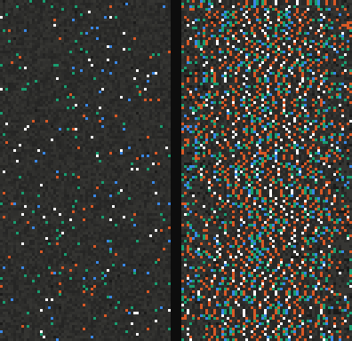
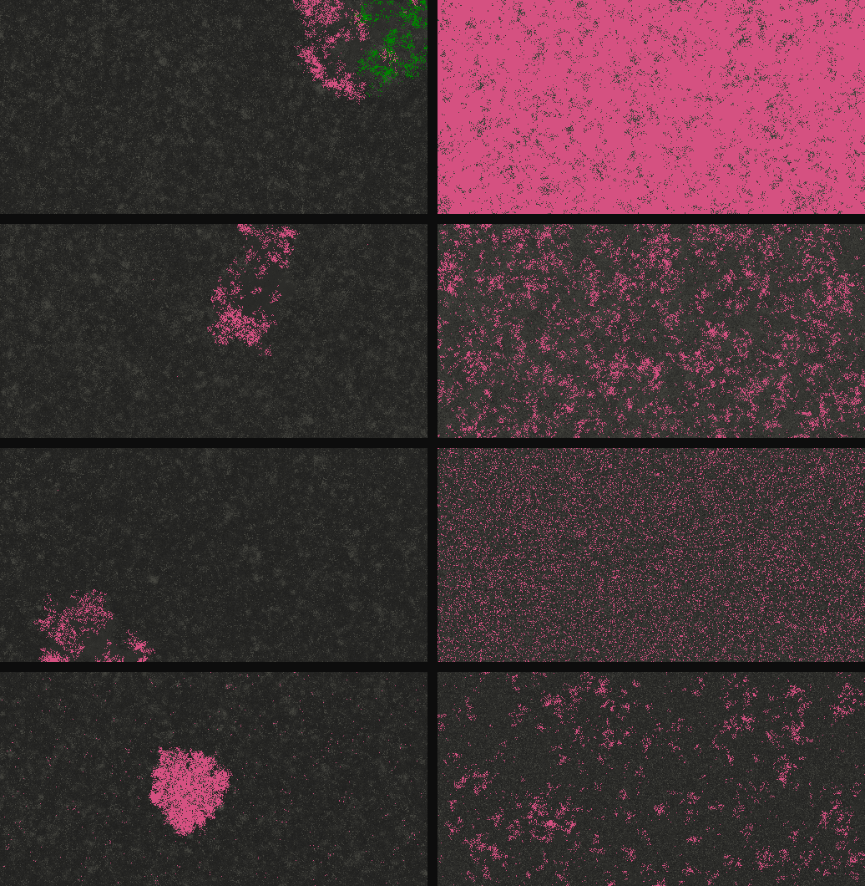
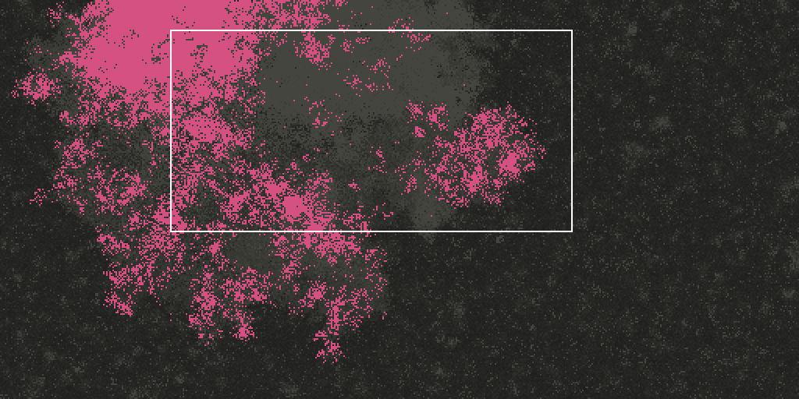
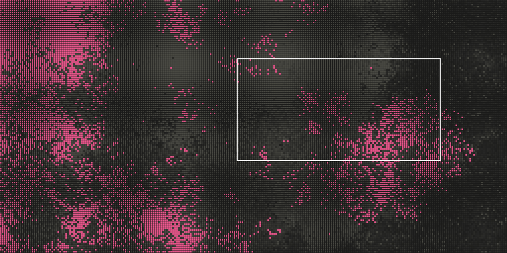
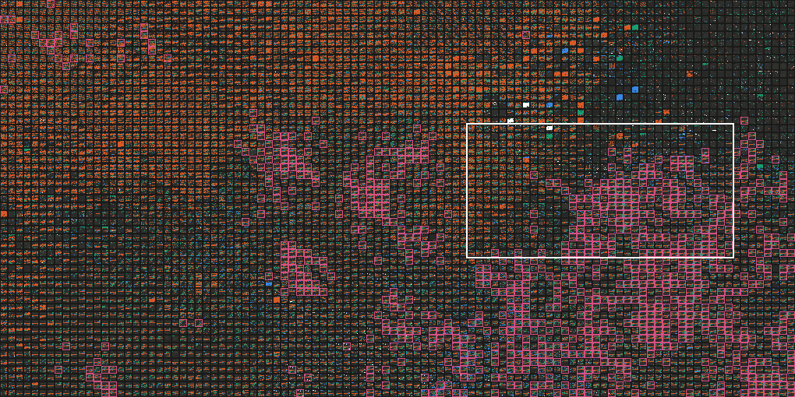
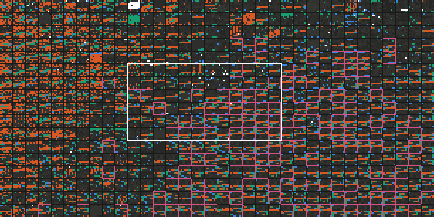
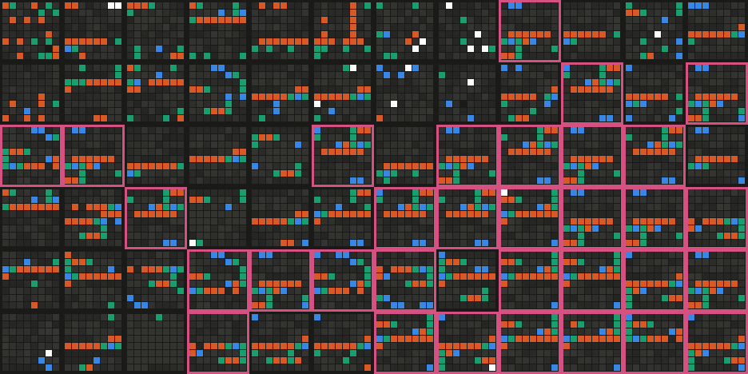

# Genesis

**Abiogènesi digital:** un univers de joguina on intentem que la vida sorgeixi sola, sense que ningú
n'escrigui el primer organisme.

*Fins al 30 d'octubre de 2026 es deia claude-origins, el nom que encara surt als registres dels experiments i a les
auditories.*

**English:** [README.en.md](README.en.md) · **Glossari català–anglès:** [docs/glossari.md](docs/glossari.md)


*Un món de 512 × 256 programes aleatoris, de l'època 1.500 a la 2.900. El número de la cantonada és l'època.
Cap a la 2.100 hi apareix una taca de programes plens d'instruccions. A la 2.200, el registre de famílies hi
reconeix replicadors i els pinta de rosa. Ningú no els havia escrit. És el món de la llavor 1006 de la sèrie
de la llei 2, i s'ha triat perquè la colònia s'hi veu bé: és un exemple, no una mostra
([d'on surten les imatges](docs/imatges/README.md)).*

**Què vol dir "vida" aquí.** És un criteri de treball, no cap afirmació sobre la vida biològica.
- **Un replicador hereditari** és un programa que es copia en un company, i la còpia també es copia.
- **La vida s'ha establert** quan, en dos censos seguits (un cada 250 èpoques), almenys l'1 % d'una mostra de
  2.048 cel·les en són.

> **English summary.** Genesis is a digital abiogenesis project, started in October 2026. Programs in
> a random "primordial soup" (the BFF language of Agüera y Arcas et al., 2024) interact and mutate, and
> heritable self-replicators sometimes emerge with no designed ancestor and no reward for copying. We design
> the laws of the world — space, currents, flow — never the organisms. The first preregistered series (160
> worlds, quiet vs. weak mixing) was **inconclusive**: life became established in 24/80 vs. 34/80 worlds
> (log-rank p = 0.067; the preregistered bound was not reached). The second one (29 worlds, 116 paired
> branches of 5,000 epochs) found that **established life lasts**: in their original condition, 93.1% of
> branches show no sustained loss within 5,000 epochs. With a weak current, life occupies on average a larger share
> of the world during the first 2,000 epochs (22/29 worlds), as expected; whether changing a world's condition shortens
> life remains open. The code is written by Claude (Anthropic)
> under the direction of a human project owner, and reviewed by **two AI auditors**. **This is not human peer
> review.** [Full English README](README.en.md).

## Què és

Tierra (1991) i Avida (1994) van estudiar l'evolució digital, però hi començava un organisme escrit a mà.
- **Una idea que ve de lluny:** que la vida aparegui sola en una "química" de programes, com a Coreworld,
  AlChemy o Amoeba.
- **El punt de partida:** el 2024, *Computational Life* (Agüera y Arcas i altres) ho va mostrar en una sopa
  de programes molt senzills, en llenguatge BFF. Va passar en un 40 % de les sopes.

Aquest projecte parteix d'aquí i es pregunta el que queda obert ([estat de la qüestió](docs/estat-questio.md)):
1. **Quines propietats** de la química i de l'entorn calen perquè hi aparegui la vida.
2. **De què depèn que s'estableixi i que duri.**
3. **Si després hi ha evolució darwiniana sostinguda.**
4. **Si els resultats són generals** o propis d'aquest llenguatge.

La regla principal: **dissenyem les lleis, mai els organismes.**
- **Què no hi ha:** replicadors inicials, premis per copiar-se, o cap instrucció que copiï un programa sencer
  d'un sol cop.
- **On viuen els organismes:** en un univers tancat. Són bytes executats pel nostre intèrpret, sense accés al
  sistema, a la xarxa ni als fitxers.

## Què hem trobat

### La sopa cobra vida



*Cada fila és un programa de 64 bytes, i cada color, una família d'instruccions:*
- *blau: les de còpia;*
- *taronja: les de bucle;*
- *verd: les que mouen els caps;*
- *blanc: les aritmètiques.*

*A l'esquerra, la sopa inicial de la llavor 1. A la dreta, la mateixa sopa 750 èpoques després, plena de
còpies d'un replicador que ningú no havia escrit.*

**Les sopes:** són de 131.072 programes aleatoris.
- **A l'article:** al cap de centenars o milers d'èpoques, en algunes sopes hi apareix un programa que es
  copia als altres i les envaeix. Passa en un 40 % de les sopes en 16.000 èpoques.
- **Al projecte:** també passa en unes sí i en d'altres no.

Hem reproduït el resultat de 2024, i n'hem seguit la història:
- **Els primers replicadors s'enverinen.** Cada còpia deixa zeros, i els zeros aturen les còpies. L'article
  de 2024 ja descriu aquest enverinament i el successor que ve després (la seva figura 2); nosaltres l'hem
  trobat a les nostres sopes i l'hem mesurat. És l'explicació que encaixa amb les dades, però no l'hem
  demostrat amb cap intervenció.
- **Un successor resistent.** En una sopa, un replicador nou converteix els zeros en 255 i hi continua
  copiant-se en un 83–96 % dels intents.
- **Palíndroms.** Els tres primers replicadors que hem trobat són palíndroms que es copien al revés, amb el
  mateix bucle de còpia. Fa pensar en una evolució convergent, però és una hipòtesi.

Vegeu les [entrades 1 i 2](quadern/index.html#entrada-1) del quadern.

### En un món amb espai



*Quatre mons de cada condició, triats a l'atzar d'entre els que la vida s'hi va establir, amb una llavor
declarada. Cada imatge és del moment de l'establiment.*
- *A l'esquerra, els mons quiets. La família de replicadors hi ocupa una sola zona, o dues.*
- *A la dreta, els mons amb un corrent feble, que cada època canvia de lloc l'1 % de les cel·les. La família
  s'hi escampa.*
- *Què marca el color: el territori de cada família, és a dir, les cel·les que en porten el nucli de codi,
  no només els replicadors que funcionen.*
- *Les xifres del cens:*
  - *en els mons quiets, els replicadors hereditaris són de l'1,0 % al 3,7 %;*
  - *en els mons amb corrent, del 2,4 % al 85,5 %.*

Al món 2D, cada programa només interactua amb els veïns. Les primeres observacions suggerien que l'espai frena
la vida, i que un corrent feble la fa néixer més sovint.

### De prop: del món al codi

Si ens hi acostem, la colònia de l'animació, a l'època 2.900, es veu així. Cada imatge marca amb un
rectangle blanc on fa zoom la següent.





*Primer, el món sencer i després un quart, on ja es veu la quadrícula: cada quadradet és un programa. Al
voltant de la colònia hi ha una zona grisa de programes plens d'instruccions, sense família.*



*La vista de codi, com a la interfície.*
- *Cada cel·la mostra els seus 64 bytes en una quadrícula de 8 × 8, amb els colors de la sopa.*
- *Les replicadores tenen un marc rosa.*
- *La zona grisa d'abans es veu taronja. Són programes amb unes 25 instruccions, dues de cada tres de bucle
  (`[` i `]`).*
- *A la dreta, fora de la colònia, els programes només en tenen unes 10.*





*Al front de la colònia, moltes replicadores repeteixen el mateix dibuix.*
- *Són còpies gairebé idèntiques d'un mateix programa, o del seu mirall, perquè es copien al revés.*
- *En aquest tros, més de la meitat se'n diferencien en 5 bytes o menys.*
- *Al costat hi ha programes que el registre de famílies no reconeix com a replicadors.*

### La primera sèrie preregistrada: no concloent

<picture>
  <source media="(prefers-color-scheme: dark)" srcset="docs/imatges/llei2-km-fosc.svg">
  
</picture>

*La sèrie:* 80 mons per condició.
- *La prova:* log-rank, Z = −1,83 (*p* = 0,067), amb un límit preregistrat de 2,004.
- *La diferència a l'època 16.000:* +12,5 punts, amb un interval de confiança del 95 % de −2,3 a +27,3.

Ho vam posar a prova amb una sèrie confirmatòria de 160 mons, amb el protocol escrit i segellat abans de
començar.
- **El resultat:** la vida s'hi va establir en el 30 % dels mons quiets (24 de 80) i en el 42,5 % dels mons
  amb corrent (34 de 80).
- **El límit:** la diferència **no hi arriba**.
- **Què vol dir:** la sèrie no permet afirmar que el corrent hi tingui cap efecte, però tampoc no el
  descarta.
- **La revisió:** els dos auditors n'han tornat a calcular la decisió pel seu compte.

Vegeu l'[entrada 8](quadern/index.html#entrada-8).

### La segona sèrie preregistrada: la vida establerta dura

Hem continuat 29 mons des del moment que s'hi va establir la vida, en la seva condició i en l'altra, amb dues
llavors per condició i 5.000 èpoques més: 116 branques ([protocol](docs/protocol-b2.md)).
- **En el seu món, la vida dura.** El 93,1 % de les branques no tenen cap pèrdua sostinguda en 5.000 èpoques
  (IC del 95 %: 73,8–98,5 %).
  - Les 4 pèrdues d'aquesta condició són d'hora, fins a *t* + 1.500.
  - Totes quatre tornen a passar de l'1 %.
- **Amb corrent, la vida ocupa de mitjana més part del món** durant les primeres 2.000 èpoques: confirmat, en 22 de
  29 mons i als dos orígens (*p* = 0,004, amb la correcció de Holm).
  - **Al final, amb corrent i sense, arriba a nivells molt semblants:** el 70,6 % i el 70,7 % als últims 8 censos
    (descriptiu, mirat després, no una prova d'equivalència). Sembla que el corrent fa que la vida ocupi el món
    abans, més que no pas que n'ocupi més.
  - **No és un descobriment:** és el que s'espera de la teoria dels fronts d'invasió. La sèrie en mesura la mida,
    però no la velocitat de cap front.
- **Si la vida dura menys quan el món canvia de condició:** no concloent (3 mons a favor, 3 en contra i 23
  iguals). Les pèrdues són rares i es concentren en pocs mons, i la prova tenia poca potència, com ja deia el
  protocol.

Vegeu l'[entrada 10](quadern/index.html#entrada-10).

### La tercera sèrie preregistrada: els zeros

Als mons on la vida es torna a perdre, quan s'hi estableix ja hi ha molts més bytes zero
([entrada 11](quadern/index.html#entrada-11)). En 8 mons on la vida baixa just després d'establir-se, hem tornat a
engegar cada món des del mateix instant, de quatre maneres i amb el mateix atzar: 132 branques
([protocol](docs/protocol-zeros.md)).
- **Contra un placebo, treure els zeros fa que la vida baixi menys, o creixi més:** confirmat, als 8 mons (*p* = 0,004, amb
  la correcció de Holm). Amb els zeros canviats, la vida creix en 5 dels 8.
  - **Què es fa:** els zeros de les cel·les que no es repliquen passen a bytes de dades. El placebo canvia, a les mateixes
    cel·les, tants bytes de dades com zeros hi ha, i hi deixa els zeros. És aparellat cel·la per cel·la, en part a les
    cel·les saturades: a les que tenen més zeros que bytes de dades no hi arriba, i deixa sense aparellar entre el 0,5 % i
    el 5,0 % dels zeros que canvia `zeros-data` a cada món.
  - **Què vol dir:** dins d'aquests mons, els zeros contribueixen a fer baixar la vida. És compatible amb la hipòtesi de
    l'autoenverinament: el replicador deixa còpies trencades plenes de zeros, i aquestes deixalles aturen les còpies
    següents. La prova no en diu el mecanisme: els zeros també poden adormir les còpies que els porten.
- **Contra el món sense tocar:** no concloent (7 mons a favor i 1 en contra, *p* = 0,035, amb un llindar de 0,025).
- **No diu res de mons nous,** perquè aquests es van triar després de veure'n les dades.
- **No és un descobriment:** l'enverinament per zeros ja és a l'article de 2024. El que hi afegeix la sèrie és la prova
  causal, amb una intervenció des d'una mateixa captura i un control.

Vegeu l'[entrada 13](quadern/index.html#entrada-13).

### El que estudiem ara

- **La maduració de la sopa abans que hi aparegui la vida,** la línia que vam triar després de l'auditoria 14:
  branques des d'una mateixa captura, que continuen la sopa o en barregen els bytes.
  - **El pilot, fet:** amb 22 mons, la vida s'estableix en el 27 % de les branques que continuen tal com són, i en el
    mateix 27 % quan es barregen tots els bytes del món. És un pilot, sense cap conclusió
    ([entrada 12](quadern/index.html#entrada-12)).
  - **La sèrie preregistrada,** amb 150 mons nous ([protocol](docs/protocol-maduracio.md)): l'envelliment dels mons
    corre des del 29-10-2026, i el protocol és a l'auditoria.
- **La mida del món,** començant pels mons petits.
- **Els ingredients de la química:** treure-li instruccions o capacitats per saber quines calen.
- **Un temps que canvia:** un corrent que alterna la calma i el temporal.

## Com es treballa

- **Preregistre.** Les sèries confirmatòries tenen un protocol escrit abans de començar
  ([protocol de la llei 2](docs/protocol-estadistic.md), [de B2](docs/protocol-b2.md) i
  [dels zeros](docs/protocol-zeros.md)). El programa que
  decideix només ho fa des d'una còpia idèntica a l'etiqueta de git del preregistre.
- **Dos auditors, tots dos d'IA.**
  - **Què revisen:** a cada iteració, dos models revisen el codi, els mètodes i els resultats, en sessions
    separades.
  - **Qui són:** l'un és una altra instància de Claude, el mateix model que desenvolupa; l'altre és un model
    diferent.
  - **El segellat:** cadascú segella el seu informe abans de llegir el de l'altre.
  - **La verificació:** l'equip comprova cada troballa amb dades. Les troballes i com es van resoldre són a
    l'[índex de les auditories](docs/auditories.md).

  No és cap revisió per experts humans.
- **Les errades es corregeixen sense esborrar.** El quadern conserva el que vam dir i hi afegeix la
  correcció, datada.
- **La història de cada món es pot reproduir exactament.** La simulació fa la mateixa història, tant al
  navegador com a Node, amb el mateix commit, la mateixa llavor i els mateixos paràmetres. Només l'entropia
  d'ordre superior varia una mica segons la versió de Node. Vegeu com [reproduir els resultats](docs/reproduir.md).
- **Qui hi treballa.** Ho desenvolupa Claude (Anthropic), amb un responsable humà que decideix la direcció i
  revisa cada canvi del simulador abans d'acceptar-lo.

## Estat i límits

- **És un projecte personal en curs,** començat el 14 d'octubre de 2026. Els resultats són preliminars, i
  no s'han publicat ni els han revisat experts humans.
- **El preregistre de la llei 2** és l'etiqueta `preregistre-llei2`.
  - **Què se'n pot comprovar:** el commit i les empremtes dels fitxers.
  - **Què no:** la data, perquè git no la certifica i el repositori era privat.
- **El preregistre de B2** és l'etiqueta `preregistre-b2`, amb un segell d'OpenTimestamps ancorat a Bitcoin
  ([`docs/preregistre-b2/`](docs/preregistre-b2/)).
  - **Què demostra Bitcoin:** que l'etiqueta existia quan es va minar el bloc 972.374 (20:25:42 UTC del
    20-10-2026), uns 6 minuts després que comencés la primera branca.
  - **El que no demostra:** que el segell es va enviar 31 minuts abans ho registren els calendaris, i que ningú no
    va mirar cap resultat ho diu l'acta.
- **El preregistre de la prova dels zeros** és l'etiqueta `preregistre-zeros`, amb un segell d'OpenTimestamps
  ancorat a Bitcoin ([`docs/preregistre-zeros/`](docs/preregistre-zeros/)).
  - **Què demostra Bitcoin:** que l'etiqueta existia quan es va minar el bloc 973.367 (07:43:35 UTC del
    27-10-2026), 51 minuts abans que comencés la primera branca. Aquesta vegada es va esperar l'ancoratge abans
    de llançar.
  - **El que no demostra:** que ningú no va mirar cap resultat. Ho diu l'acta.
- **Com citar-ho:** [`CITATION.cff`](CITATION.cff). **Com participar-hi:** [`CONTRIBUTING.md`](CONTRIBUTING.md).

## Com obrir-ho

Cal Node.js, sense cap dependència. Per a una instal·lació nova, feu servir una versió amb manteniment
(Node 22 o 24): les proves hi passen. Les versions 16 i 20 són les dels registres antics, i només calen per
reproduir-los byte a byte.

```bash
node server.mjs
```

Obriu <http://localhost:8420>: hi ha la sopa, el món 2D (amb zoom des dels territoris fins al codi) i el
quadern.
- **Què demana al navegador:** *module workers* i `CompressionStream` amb `deflate-raw`.
- **Els navegadors provats:** Chrome, Edge i els altres basats en Chromium. Amb aquests s'ha comprovat la
  reproduïbilitat.

Una prova ràpida sense gràfics, d'uns 10–15 segons:

```bash
node sim.mjs --world 64x64 --seed 1 --epochs 300 --census 100
```

**Un món de la mida de la sèrie,** fins a l'època 16.000, tarda una hora de mediana, i fins a més de tres
hores:

```bash
node sim.mjs --world 512x256 --seed 1 --epochs 16000
```

`node sim.mjs` sense `--world` simula la sopa barrejada, i `node sim.mjs --help` en dona totes les opcions.
Les proves:

```bash
npm test
```

## Estructura del repositori

| On | Què hi ha |
|---|---|
| [`quadern/`](quadern/) | El quadern de laboratori: què hem fet, què hem trobat i les preguntes obertes. Es llegeix obrint-lo amb `node server.mjs`. |
| [`docs/`](docs/) | La visió i les decisions ([`disseny.md`](docs/disseny.md)), l'[estat de la qüestió](docs/estat-questio.md), el protocol estadístic, el calibratge del cens, les captures clau, com [reproduir els resultats](docs/reproduir.md), el [glossari](docs/glossari.md) i les imatges. |
| [`fase1/`](fase1/) | La sopa primordial: l'intèrpret BFF, la sopa, els generadors aleatoris i la interfície del navegador. És el nucli que fan servir totes les fases. |
| [`fase2/`](fase2/) | El món 2D i les seves lleis (espai, corrents, flux), el cens de la vida, el registre de famílies i les eines d'anàlisi i d'estadística de totes les sèries. Els resultats dels experiments són a `fase2/resultats/`. |
| [`fase3/`](fase3/) | Dades: les llistes i els registres dels experiments de la llei 3. El codi és a `fase2/`. |
| [`eines/`](eines/) | Les eines per llançar lots d'experiments i seguir-los, desplegar a la màquina virtual, arxivar les captures i generar les imatges, i la comparació de l'intèrpret amb cubff. |
| [`test/`](test/) | Les proves: l'intèrpret, el món i el cens, la línia d'ordres, els lots, el servidor, l'estadística i el preregistre, el generador del quadern, l'eina de les alíquotes, l'oracle de cubff i el determinisme. |
| `sim.mjs`, `server.mjs`, `index.html` | La simulació sense gràfics, el servidor local i la portada. |

Els noms de les carpetes són històrics. Els registres i les etiquetes els citen, i per això no es canvien.

**Notes de reproduïbilitat.**
- **El generador aleatori:** des de l'auditoria 1, és el v2 (xoshiro128\*\*), i des de la iteració 3, el
  cens per defecte és el v3. Per reproduir experiments anteriors cal `--rng v1 --census-version v2`.
- **Les versions de Node:** amb Node 16 i Node 20, la història del món és la mateixa. L'entropia d'ordre
  superior, en canvi, difereix a la tercera xifra decimal, perquè cada versió porta un zlib diferent.
- **La fidelitat de l'intèrpret:** dona exactament el mateix resultat que cubff, la implementació original de
  l'article, en 200.000 cintes ([`eines/cubff/`](eines/cubff/README.md)). L'única diferència és la taxa de
  mutació: el projecte fa servir el 0,024 % de l'article, i cubff, 1/4.096.
- **Les imatges** d'aquest README les genera `eines/imatges.mjs` a partir de les captures, i es poden tornar
  a fer ([les ordres i les captures](docs/imatges/README.md)).

## Llicència i crèdits

- **Codi:** Apache 2.0 ([`LICENSE`](LICENSE)).
- **Quadern i documentació:** Creative Commons Reconeixement 4.0 ([`LICENSE-docs.md`](LICENSE-docs.md)).
- **Dades dels experiments:** Creative Commons Reconeixement 4.0 ([`LICENSE-data.md`](LICENSE-data.md)).
- **Crèdits** ([`NOTICE`](NOTICE)).
  - El simulador és una reimplementació independent en JavaScript del llenguatge BFF de *Computational
    Life* (Agüera y Arcas i altres, 2024, arXiv:2406.19108), contrastada amb cubff, la seva implementació de
    referència (Google LLC, Apache 2.0).
  - El banc de proves incorpora una funció de referència adaptada de `bff.inc.h` de cubff, amb l'atribució a
    `NOTICE`.
  - El projecte parteix d'aquell treball: no presenta com a original que en una sopa BFF hi apareguin
    replicadors sols.
